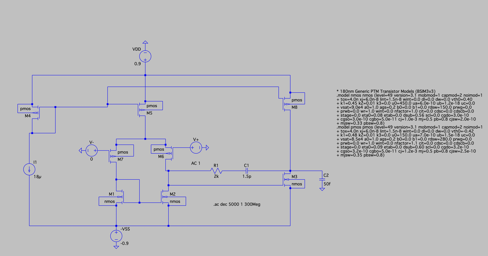
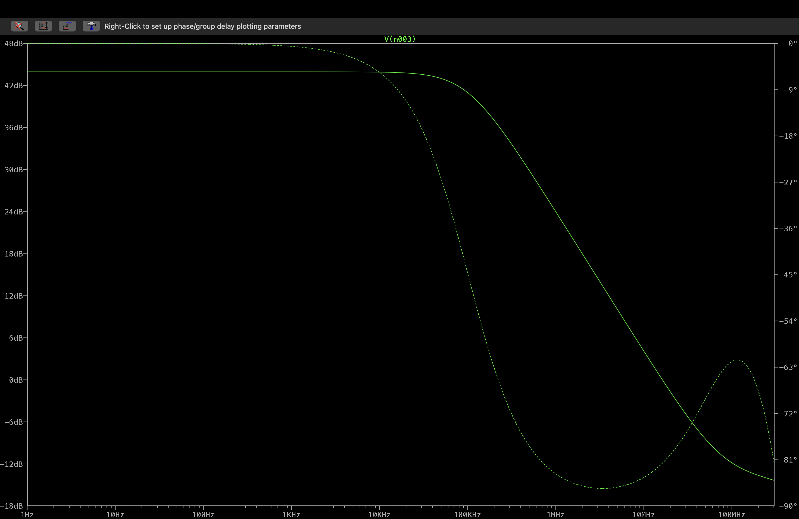

# Two-Stage CMOS Operational Amplifier using 180nm with Miller Compensation

## Overview
This project involves the design and simulation of a two-stage CMOS operational amplifier using LTspice. Miller compensation and a nulling resistor are incorporated to improve frequency response and stability while balancing gain, bandwidth, slew rate, and power consumption.

The design is based on 180 nm CMOS technology assumptions.

## Objectives
- Design and simulate a two-stage CMOS operational amplifier.
- Understand the operation of the differential input stage and second gain stage.
- Study Miller compensation and the effect of a nulling resistor on frequency response.
- Analyze gain, bandwidth, phase margin, slew rate, and power consumption.
- Explore trade-offs between gain, stability, bandwidth, and power.

## Tools and Technology
- Simulation Tool: LTspice
- Circuit: Two-stage CMOS operational amplifier
- Technology: 180 nm CMOS design assumptions
- Compensation: Miller compensation with a nulling resistor

## Circuit Architecture
The circuit consists of a differential input stage, a second gain stage, a biasing network, and a Miller compensation network with a nulling resistor.

The differential stage processes the input voltage difference, while the second stage provides additional voltage gain. The compensation network helps control the frequency response and improve stability.

## Simulation Results

| Parameter | Simulated Value |
|-----------|-----------------|
| DC Gain | 44 dB |
| Phase Margin | 98° |
| Unity-Gain Bandwidth | 16.27 MHz |
| Slew Rate | 10.9 V/µs |
| Power Consumption | 198 µW |

These values are based on simulation and depend on the circuit configuration and test conditions.

## Analysis Performed
- DC operating-point analysis to examine transistor bias conditions.
- AC analysis to evaluate gain, unity-gain bandwidth, and phase margin.
- Transient analysis to study time-domain response and slew rate.
- Power analysis to estimate circuit power consumption.

## Repository Contents
- LTspice schematic file.
- Simulation plots and results.
- Design theory and supporting calculations.

## How to Run
1. Install LTspice.
2. Download or clone this repository.
3. Open the schematic file in LTspice.
4. Ensure all required model definitions and dependencies are available.
5. Run the simulations and compare the results with the documented plots.

## Learning Outcomes
- Understanding of two-stage CMOS amplifier design.
- Practical study of Miller compensation and frequency response.
- Analysis of amplifier stability and transient performance.
- Understanding of gain, bandwidth, slew rate, and power trade-offs.

## Circuit Schematic

The complete two-stage CMOS operational amplifier schematic implemented in LTspice.

## AC Analysis

The AC response of the two-stage CMOS operational amplifier, showing its gain and phase variation with frequency.

The simulated low-frequency gain is approximately 44 dB, with a phase margin of 98° at the unity-gain crossover frequency.
